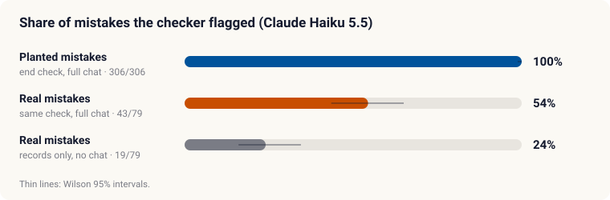

# Perfect in the lab, 54% in the wild

**Do AI checkers catch the mistakes AI agents actually make?**

AI agents now take real actions for customers: refunds, exchanges, cancellations, address changes. A common safety net
is a **checker**, a second LLM that reviews each proposed action before it runs. Checkers are usually evaluated on
mistakes we **plant** ourselves. This project asks whether a high score on planted mistakes says anything about the
mistakes agents **really** make.

It doesn't. The same checker catches **100%** of planted mistakes but only **54%** of real ones. Its own explanations
show why: it treats the customer's "yes" as proof that the action is right.

<p align="center"></p>

**[Interactive explorer](https://kromanczuk.github.io/agent-blindspots/)** · **[Poster (PDF)](docs/poster.pdf)** ·
**[Methods](docs/METHODS.md)**


---

## Findings

| | Result |
|---|---|
| **Planted vs. real** | One full-chat AI check at the end catches 306/306 planted faults (100%), but only 43/79 real mistakes (54%, 95% CI 43–65%). |
| **Where checkers belong** | Free rule checks after every agent plus one AI check at the end catch every planted fault for $0.86 per 1,000 runs. Checking after every agent catches nothing extra at ~5× the cost and ~4× the delay. |
| **Context matters** | A checker without the conversation catches 80% of faults planted at hand-off 1 vs. 99% at hand-off 4, with 52% false alarms. On real mistakes it catches 24%. |
| **Why real mistakes are harder** | 30% of real mistakes leave no clue in the chat. The checker caught 38/51 mistakes that had a clue and 1/22 that didn't. |
| **Explanations (XAI)** | In 33 of 36 misses, the checker approved because "the action matches the customer's request"; 25 cite the customer's confirmation. |
| **Prompting doesn't fix it** | A "skeptical" prompt (a yes is not proof) leaves the catch rate at 53% (exact McNemar p = 1.0), and false alarms move from 7% to 4% (p = 0.51, not significant). |

**If you deploy AI agents:** check cheaply (rules everywhere, one full-context AI check at the end); don't trust
planted-mistake scores, and measure checkers on real failures instead; and look beyond the checker: make agents read
back exact item details and send high-risk changes to a human.

## Explainability in this project

- **Explanations as evidence.** Every checker verdict comes with a written justification. Reading the misses, rather
  than only counting them, is what reveals the failure mode: the checker approves whatever the customer agreed to.
- **"Right for the right reason."** In Experiment 1, the analysis checks whether a flag names the field that was
  actually planted, not just whether something was flagged.
- **Evaluation validity.** The core contribution is a warning about evaluation practice: a guardrail evaluated only on
  synthetic faults can look perfect while missing half of the real ones.
- **Label quality without hand labels.** Real mistakes are labelled by two independent signals that must agree: an
  outcome filter and an adjudicator that sees the customer's secret goal. The filter alone was wrong for 34% of
  suspected mistakes.
- **Explanations are evidence, not ground truth.** A model's stated reason need not be the reason it actually used
  (Turpin et al., 2023). The explanation findings are therefore read alongside behaviour: the checker *says* it trusts
  the customer's confirmation, and it *does* miss almost every mistake the chat gives no clue about (1 of 22).

## Quickstart

Requirements: Python 3.11+ with [uv](https://docs.astral.sh/uv/), and Node 20+ for the website.

```bash
git clone https://github.com/kromanczuk/agent-blindspots && cd agent-blindspots
make setup        # uv sync + npm install
make reproduce    # recompute every reported number from results/ and check it (no API keys, no download)
make site         # open the explorer at http://localhost:5173/agent-blindspots/
```

`make reproduce` prints the full report (also written to `results/summary.json`) and runs the tests. The tests include
a check that every number above follows from the saved results.

### Re-running the experiments

Re-running calls paid APIs, and LLM verdicts vary between runs (about 1 in 10 flip), so expect close but not identical
numbers.

```bash
make data                      # tau2-bench at the pinned commit (~700 MB) into data/tau2-bench
cp .env.example .env           # add ANTHROPIC_API_KEY and OPENAI_API_KEY, then `set -a; source .env`
make dry-run                   # all three experiments end to end with stub replies, no API calls

uv run blindspots lab          # Experiment 1  (~5,600 calls, Claude Haiku 5.5)
uv run blindspots wild         # Experiment 2  (~650 calls: Haiku checker + GPT-6.2 Sol adjudicator)
uv run blindspots skeptic      # Experiment 2b (~450 calls)
uv run blindspots analyze      # summarise
uv run blindspots export-site  # rebuild the explorer's data
```

Every command has `--help`. Models and providers are flags (`--provider`, `--checker-model`, `--adjudicator-model`,
...); Anthropic, OpenAI and Gemini (`uv sync --extra gemini`, Vertex AI env vars) are supported. Runs
make one test call before spending anything, stop after repeated API failures, and resume from a progress file if
interrupted.

## Repository map

```
src/blindspots/
  tau2.py            loading tau2-bench recordings; lab cases; the pool of real write actions
  faults.py          planted faults (easy / medium / hard hand-off faults, confirmed-in-conversation faults)
  guards.py          the three check kinds (rules / full chat / records only), six guard configs, trace scoring
  prompts.py         every prompt, verbatim as run
  llm.py             one thread-safe JSON client for Anthropic, OpenAI and Gemini, with retries and token tracking
  experiments/       lab.py (Exp 1), wild.py (Exp 2), skeptic.py (Exp 2b)
  analysis.py        recomputes every reported number from results/
  stats.py           Wilson intervals, exact McNemar test
  export.py          JSON + figure for the website
results/             the saved outputs of the final runs (see results/README.md)
site/                the interactive explorer (React + Vite, deployed to GitHub Pages)
tests/               unit tests and the reproduction check
docs/                METHODS.md, the poster, figures
THIRD_PARTY_NOTICES.md  τ²-bench licence (its conversations appear in results/ and the explorer)
```

## Design decisions

- **Score every guard configuration on the same runs.** Experiment 1 runs every check at every checkpoint once and logs
  the verdicts; each configuration is then scored from the log. The comparison is exact, and it costs one run instead
  of six.
- **Coherent faults.** A "medium" fault swaps in the customer's *other* real order together with that order's items,
  so nothing looks broken. Agents' free-text notes are logged but never forwarded, so an original ID can't leak
  downstream and silently fix a fault.
- **Precision over recall in labels.** A real case is kept only if the outcome filter and the adjudicator agree. The
  adjudicator is from a different model family than the checker, to reduce self-preference bias.
- **The checker sees what production would.** In Experiment 2 the checker gets the conversation and the proposed
  action, never the secret goal.
- **Change one thing at a time.** Experiment 2b changes only the prompt, and reruns the original prompt alongside it, so
  run-to-run noise is measured rather than assumed.

## Related work

- **LLM-as-a-judge.** Using one LLM to grade another is now standard (Zheng et al., 2023), and judges favour their own
  outputs (Panickssery et al., 2024). Here the checker and the adjudicator come from different model families, and the
  question is not agreement with humans but whether the judge catches errors that matter.
- **Guardrails.** Safety classifiers such as Llama Guard (Inan et al., 2023) screen content for policy categories.
  Action checkers for agents face a harder problem: an action can be perfectly harmless in general and still wrong for
  *this* customer.
- **Agent benchmarks.** τ-bench (Yao et al., 2024) and τ²-bench (Barres et al., 2025) measure whether agents finish
  tasks. This project reuses their recorded failures as a test set for the *checkers* that are meant to stop them.
- **Explanations.** "Right for the right reasons" (Ross et al., 2017) asks whether a model is correct for the
  intended cause, which is the idea behind checking whether a flag names the planted field. Explanations can also be
  unfaithful (Turpin et al., 2023), which limits how far they can be trusted on their own.
- **What's new here** is the comparison itself: the same checker scored on planted faults and on real agent mistakes
  from the same benchmark, with real mistakes labelled automatically, and the checker's own explanations used to say
  why the two scores differ.

<details>
<summary>References</summary>

- Barres, V., Dong, H., Ray, S., Si, X., & Narasimhan, K. (2025). τ²-Bench: Evaluating conversational agents in a
  dual-control environment. *ICML 2026*. arXiv:2506.07982.
- Inan, H., et al. (2023). Llama Guard: LLM-based input-output safeguard for human-AI conversations. arXiv:2312.06674.
- Panickssery, A., Bowman, S. R., & Feng, S. (2024). LLM evaluators recognize and favor their own generations.
  *NeurIPS 2024*.
- Ross, A. S., Hughes, M. C., & Doshi-Velez, F. (2017). Right for the right reasons: Training differentiable models by
  constraining their explanations. *IJCAI 2017*.
- Turpin, M., Michael, J., Perez, E., & Bowman, S. R. (2023). Language models don't always say what they think:
  Unfaithful explanations in chain-of-thought prompting. *NeurIPS 2023*.
- Yao, S., Shinn, N., Razavi, P., & Narasimhan, K. (2024). τ-bench: A benchmark for tool-agent-user interaction in
  real-world domains. arXiv:2406.12045.
- Zheng, L., et al. (2023). Judging LLM-as-a-judge with MT-Bench and Chatbot Arena. *NeurIPS 2023*.

</details>

## Responsible AI

- **Who is harmed.** A missed mistake means a real customer gets the wrong refund, item or address, and usually only
  finds out after the change has gone through. The customer said "yes", so the error is easy to blame on them.
- **Over-trust.** A guardrail that scores 100% on planted tests invites deployment with less human oversight. The main
  result is a warning against that: report checker performance on real failures, with intervals, before relying on it.
- **Human oversight.** The recommendation is to keep humans in the loop for high-risk or irreversible changes, and to
  make agents read back exact details so that the customer, not only the checker, can catch the error.
- **Data and privacy.** All customers, orders and addresses are synthetic, from τ²-bench. No personal data was used,
  and no humans were involved as subjects.
- **Cost.** About 6,700 model calls, mostly to a small model; each experiment was run once, and every number can be
  recomputed from the saved outputs without any further calls.

## Limitations

- Customers are simulated (GPT-4.1); a simulated customer sometimes accepts a wrong change a real one wouldn't.
- One checker model family (Claude Haiku 5.5) and one domain (retail).
- Labels come from an LLM adjudicator, which can be wrong; requiring agreement with the outcome filter reduces, but
  doesn't remove, label noise.
- Planted and real mistakes come from different case sets, so 100% vs. 54% compares two test suites, not matched pairs.
- Modest samples with wide intervals; only 12 conversation-level ("confirmed") faults took hold.
- Checker verdicts change about 1 in 10 between identical runs (17 of 178).
- The explanation analysis uses simple keyword rules and is approximate, and stated explanations may not be faithful
  to how the checker actually decided.

Known quirks in the saved results, and how the analysis handles them, are listed in
[docs/METHODS.md](docs/METHODS.md#known-quirks-in-the-saved-results).

## Data and models

- **Data:** [τ²-bench](https://github.com/sierra-research/tau2-bench) retail by Sierra Research (MIT licence), pinned to
  commit `768f3d8`. 114 tasks; 1,824 recorded conversations (Claude 3.7 Sonnet, GPT-4.1, GPT-4.1 mini, o4-mini × 4
  trials). The benchmark isn't bundled; `make data` downloads it. The saved results and the explorer's data include
  conversations from it, used under its licence ([THIRD_PARTY_NOTICES.md](THIRD_PARTY_NOTICES.md)).
- **Models:** agents and checkers are Anthropic `claude-haiku-5-5`; the adjudicator and clue judge are OpenAI
  `gpt-6.2-sol`. About 6,700 model calls across the final runs, each experiment run once.
- **API keys** (only to re-run): `ANTHROPIC_API_KEY`, `OPENAI_API_KEY`; for Gemini on Vertex,
  `GOOGLE_GENAI_USE_VERTEXAI`, `GOOGLE_CLOUD_PROJECT`, `GOOGLE_CLOUD_LOCATION`.

## Citation

See [CITATION.cff](CITATION.cff). Code is MIT-licensed ([LICENSE](LICENSE)); τ²-bench data is © Sierra Research, MIT
([THIRD_PARTY_NOTICES.md](THIRD_PARTY_NOTICES.md)).
